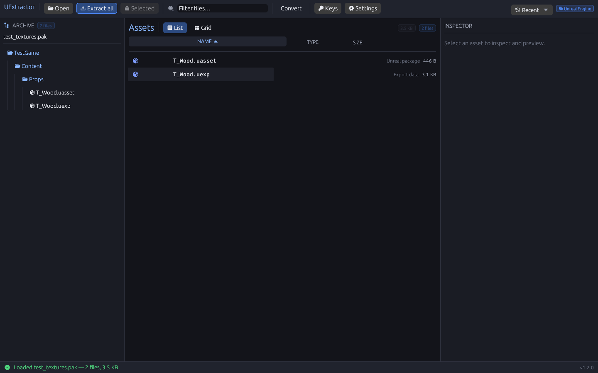
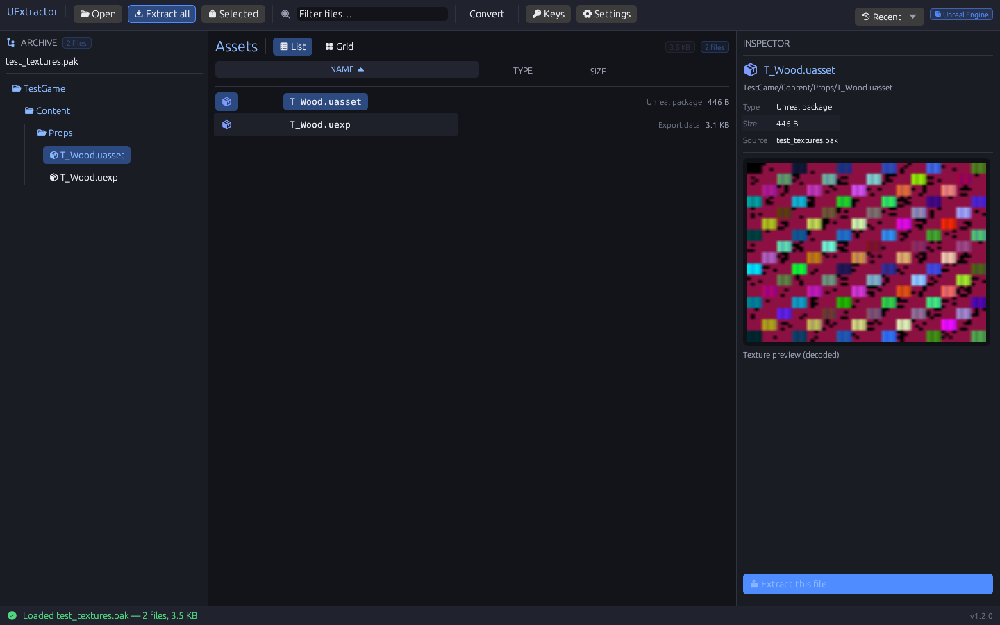
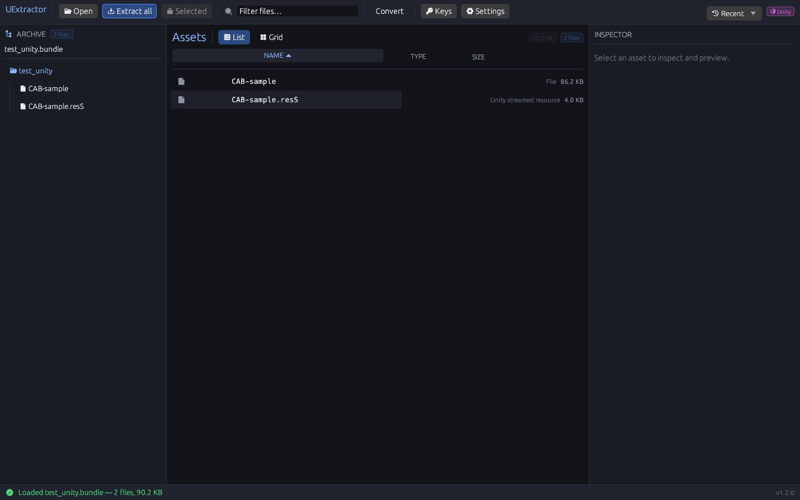
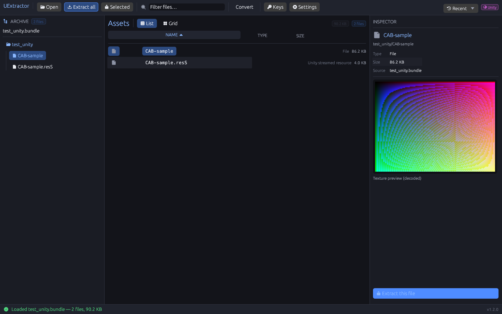
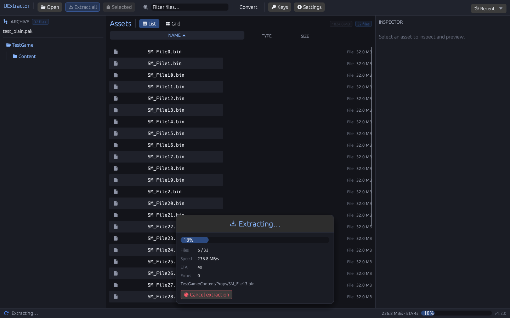
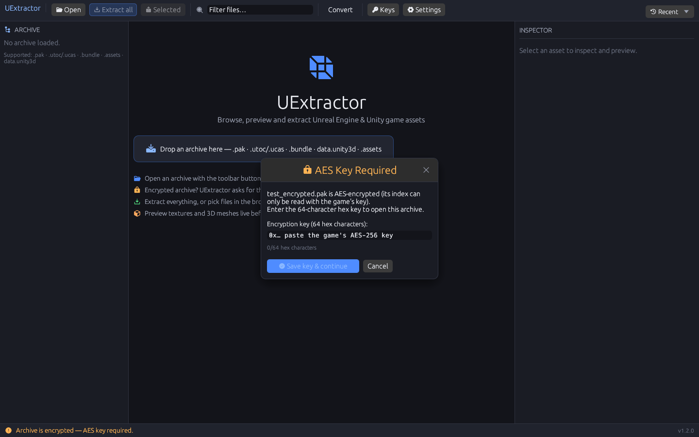

<div align="center">

# UExtractor

**Fast, parallel Unreal Engine + Unity asset extractor — written entirely in Rust.**

GUI + CLI · UE4 & UE5 (.pak/.utoc/.ucas) · Unity (.bundle/.unity3d/.assets/level*/sharedassets*) ·
AES-256 + UnityCN · Oodle (Kraken/Mermaid/Selkie/Leviathan) · GLTF · PNG/DDS · JSON

</div>

---

## What it does

UExtractor mounts Unreal Engine archive files as a virtual filesystem, extracts them in
parallel across all CPU cores, and converts game assets into industry-standard formats:

| Input | Output |
|---|---|
| `UTexture2D` (DXT1/3/5, BC4, BC5, BC7, ASTC, ETC2, BGRA, FloatRGBA, G8…) | **PNG** (decoded), **DDS** (original compression preserved) |
| `UStaticMesh` / `USkeletalMesh` (cooked vertex buffers, LODs) | **GLTF 2.0 (.glb)**, OBJ fallback |
| `SoundWave` (OGG / FLAC / WAV / ADPCM payloads) | **WAV / OGG** (stream copy or ADPCM→PCM) |
| `DataTable`, `Curve`, `StringTable`, materials, blueprints, any object | **JSON** (properties, imports, exports, metadata) |

## Supported formats

- **`.pak`** — UE4.0 → UE5.x, versions 1–11 (path hash index, Fnv64BugFix), full & partial
  directory indexes, encoded entries, encrypted indices, per-entry encryption, patch archives
- **`.utoc` + `.ucas`** — IOStore (zen) containers, TOC versions 1–8, both header layouts
  (UE4.25–5.3 and UE5.4+), partitions, perfect-hash maps, encrypted directory indices,
  container headers v−1…5, package store entries
- **Compression** — Oodle (official oo2core 2.9.10, hash-verified runtime download),
  Zlib, Gzip, LZ4, Zstd, None
- **Encryption** — AES-256 ECB (UE FAES3) for indices and payloads

### Unity Engine support (v1.2)

- **AssetBundles** — UnityFS / UnityWeb / UnityRaw (format 6/7, big-endian headers),
  LZ4 / LZ4HC / LZMA blocks, block-info-at-end and 16-byte-aligned layouts (2019.4.15+),
  Unity's official UnityCN encryption (16-char key, validated via signature check)
- **SerializedFiles** — `.assets`, extensionless `level*`/`sharedassets*`/`globalgamemanagers*`,
  `data.unity3d`, `CAB-*` nodes inside bundles; serialized file versions 3–26 (Unity 3.4 → 6000.x),
  32/64-bit path ids, big-endian headers
- **Type trees** — embedded trees (v10/v12/23 "mhtt" blobs + legacy form) and stripped trees
  resolved through an embedded AssetRipper TPK type database (exact layouts for every class
  and engine version)
- **Streamed data** — `.resource` / `.resS` files (audio, video, mesh vertex streams), resolved
  inside bundles or as sibling files — the Unity analogue of UE's `.ubulk`
- **Asset conversion** — Texture2D (RGBA32, DXT1/5, BC4/5/6/7, ASTC, ETC2, EAC, ATC, PVRTC,
  crunched DXT1/DXT5/ETC2 via Unity's crunch), Sprite (rect crop from atlas), Mesh → **GLB**,
  AudioClip → payload (`.fsb`/`.ogg`/`.mp3`/`.wav`), TextAsset, Material/GameObject/AssetBundle → JSON
- **GUI/CLI** — same mount pipeline as UE archives: browse, preview (decoded textures/sprites,
  object lists), extract with conversion; UnityCN key prompt before extraction

## Quick start (CLI)

```sh
# inspect an archive
uex info pakchunk0-WindowsNoEditor.pak

# list contents
uex list pakchunk0-WindowsNoEditor.pak --filter textures

# extract everything (parallel, saturating storage)
uex extract pakchunk0-WindowsNoEditor.pak --out extracted

# extract + convert (PNG/DDS/GLB/JSON/WAV)
uex extract pakchunk0-WindowsNoEditor.pak --convert auto --out out

# AES-encrypted game
uex extract Game.pak -k 0x0123456789ABCDEF... --convert auto --out out

# IOStore containers (UE5)
uex list global.utoc
uex extract . --convert auto --out out        # directory mode: mounts all paks+utocs

# Unity AssetBundle / serialized files (auto-detected)
uex list char_118_yuki.ab
uex extract data.unity3d --convert auto --out out

# Unity encrypted (UnityCN) — key is the 16-char "statistic" key
uex test-key GameBundle.ab -k YourUnityCNKey!
uex extract GameBundle.ab -k YourUnityCNKey! --convert auto --out out

# no test game handy? generate byte-exact synthetic archives (UE + Unity)
uex gen-testdata --out testdata --unity
```

Exit codes: `0` success · `1` runtime error · `2` usage error. `--format json` gives
pipeline-friendly machine output.

## Quick start (GUI)

```sh
uex-gui
```

Dark-themed professional UI: archive tree browser, asset list/grid, live previews
(decoded textures, software-rendered 3D mesh viewport with drag-rotate), batch
extraction queue with progress/speed/ETA/cancel, AES key manager, export settings,
drag-and-drop, recent archives. Encrypted archives raise a **key prompt before any
extraction is attempted** — no more cryptic decompression errors.

## Screenshots

| | |
|---|---|
|  |  |
|  |  |
|  |  |

All screenshots are captured from the real application (autoshot mode drives the actual
UI under Xvfb and grabs the X11 framebuffer) — no mockups.

## Building

```sh
cargo build --release
# binaries: target/release/uex (CLI) and target/release/uex-gui
```

Requires Rust 1.75+. No external C dependencies. The Oodle library is loaded at runtime
(placed next to the executable, found via `UEX_OODLE_LIB`, or auto-downloaded with
SHA-256 verification from the official EpicGames.Oodle SDK mirror). Without Oodle the
tool still fully supports Zlib/Gzip/LZ4/Zstd archives.

## Testing

```sh
cargo test --workspace
uex gen-testdata --out testdata --unity   # byte-exact synthetic archives (PAK v11, encrypted, IOStore v5, UnityFS, .assets)
uex bench --size-mb 512 --compression oodle
```

The test suite builds synthetic PAK/IOStore/Unity archives from scratch and round-trips
them through the real parsers — covering all compression methods, AES-encrypted indices
and entries, multi-block entries, zen package headers, name maps, asset conversion, and
Unity bundles/serialized files/typetrees. Unity results were cross-validated against
UnityPy (reference implementation): byte-identical textures and audio on real game data.

## Performance

Measured on a 2-core cloud VM (hypervisor-limited; scales further on real hardware):

| Workload | Throughput |
|---|---|
| Oodle decompression (Kraken payload) | ~1.7 GB/s |
| LZ4 extraction | ~0.9–1.3 GB/s |
| Zlib extraction | ~0.43 GB/s |
| AES-256 encrypted extraction | ~0.35 GB/s |
| Memory (1 GB archive) | **10 MB peak RSS** |

## Architecture

```
uex-core     archive parsers (PAK/IOStore + Unity bundles/serialized files), crypto,
             compression, uasset/uexp/uubulk, property serialization (versioned +
             unversioned), typetrees + TPK database, converters, exporters
uex-cli      full CLI (info/list/extract/bench/test-key/gen-testdata)
uex-gui      eframe/egui desktop app (tree, previews, 3D viewport, queue, key manager)
uex-testdata synthetic archive builders used by the test suite
```

## Legal

UExtractor parses published game archives for interoperability and archival purposes.
The Oodle SDK binary is Epic's property and is loaded (or downloaded with hash
verification) at runtime rather than redistributed by this repository. Respect the EULA
of any game you extract assets from; do not redistribute copyrighted content.

## License

MIT
